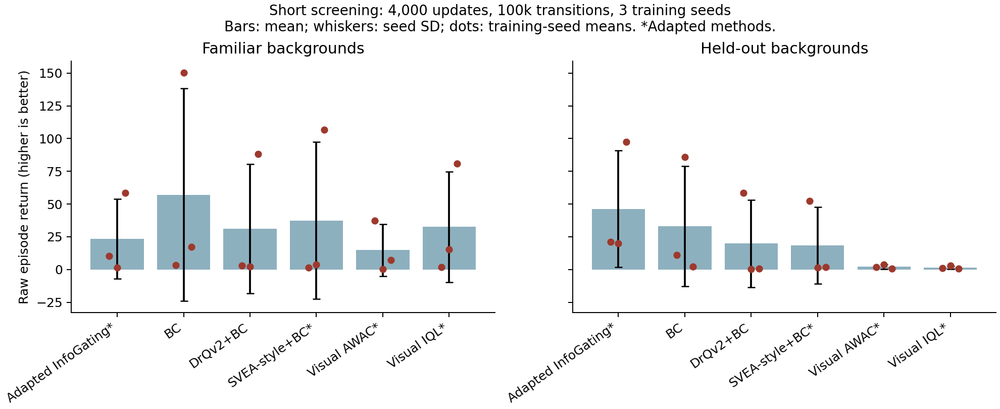

# Additional algorithms: small training comparison

Date: 6 November 2026. Status: all 18 training runs and 108 evaluation episodes completed.

The highest observed held-out average was **Adapted InfoGating***, at **46.28**. This is a preliminary ranking under one short training protocol, not a reliable claim that this algorithm is best in general.

## What was tested

Three new candidates were added: IQL (learn values using recorded actions), AWAC (copy better actions more strongly), and SVEA-style augmentation (make original and augmented images predict a shared value target). Fresh BC, DrQv2+BC and InfoGating runs serve as anchors. Asterisks indicate adaptations, not original-paper reproductions.

All runs used the existing 100,000-transition / 200-episode distracted cheetah subset, 4,000 updates, batch 16 and training seeds 0--2. No clean observations were used for training, and no evaluation transitions were added to the dataset.

## Measured results

Returns are raw episode rewards: higher is better. Each value is mean +/- sample SD across three independently trained policies, after averaging three episodes per policy in each condition.

| Method | Familiar return | Held-out background return | Training seconds/run |
|---|---:|---:|---:|
| Adapted InfoGating* | 23.43 +/- 30.59 | 46.28 +/- 44.47 | 285.4 |
| BC | 57.10 +/- 81.14 | 33.06 +/- 45.90 | 60.4 |
| DrQv2+BC | 31.18 +/- 49.38 | 19.88 +/- 33.39 | 138.4 |
| SVEA-style+BC* | 37.33 +/- 59.94 | 18.52 +/- 29.31 | 191.7 |
| Visual AWAC* | 14.92 +/- 19.84 | 2.10 +/- 1.70 | 125.3 |
| Visual IQL* | 32.57 +/- 42.27 | 1.55 +/- 1.17 | 177.3 |

### Dependence on the evaluation case

Each entry below averages the three trained policies on one held-out evaluation seed. These are descriptive breakdowns, not additional independent training repetitions.

| Method | Eval seed 701 | Eval seed 702 | Eval seed 703 |
|---|---:|---:|---:|
| Adapted InfoGating* | 96.83 | 2.57 | 39.46 |
| BC | 97.56 | 0.60 | 1.01 |
| DrQv2+BC | 58.07 | 0.84 | 0.72 |
| SVEA-style+BC* | 52.85 | 1.91 | 0.80 |
| Visual AWAC* | 5.66 | 0.29 | 0.35 |
| Visual IQL* | 3.07 | 0.94 | 0.63 |

Total measured training-update time: 48.9 minutes. Loading, initialization, checkpoint writes and simulator evaluation are excluded.

## What this does and does not tell us

- The screen identifies candidates for a longer, predeclared follow-up. A low score here can reflect slow learning, unsuitable default hyperparameters or implementation adaptation; it does not disprove a published method.
- The earlier six-method pilot used equal training time, whereas this screen uses equal update counts. Its old scores must not be mixed into this ranking.
- These are static-within-episode distractions. The reused evaluator leaves dynamic=False; fixed_distraction=False only changes how distractions are sampled, not whether they move.
- The evaluation videos and seeds have been used in earlier experiments. This is a development benchmark; any follow-up claim needs new held-out conditions.
- Only three training seeds and one task were tested. The nine episodes per condition per method are not nine independent training seeds. No significance or convergence claim is made.
- InfoGating retains its original warm-up and has only 1,501 full gate updates here. Its architecture and learning rate differ from the value-based agents. The comparison cannot isolate the causal benefit of gating.
- IQL and AWAC are adapted to the shared visual encoder, scheduled-normal actor and three-step target. SVEA is adapted to DrQv2+BC with RGB gains. None is a faithful published benchmark reproduction.

## Verification

All six conditions passed finite-update, bounded-action, changed-encoder and exact next-update checkpoint/resume tests. Runs save every 250 updates. The data check confirms 200 complete episodes and stores the source-manifest checksum. The analysis refuses missing runs, wrong update counts, duplicated evaluation cases or wrong episode lengths. Full logs and checkpoints remain outside Git in the experiment folder.

## What to do next

Compare the leading candidate with BC, DrQv2+BC and InfoGating using a substantially longer budget, separate tuning conditions, additional training seeds and new background sources. Check reward-learning diagnostics before adding domain-adversarial alignment. Do not change the submitted paper on the basis of this exploratory screen alone.

## Papers and implementation notes

1. I. Kostrikov, A. Nair and S. Levine, *Offline Reinforcement Learning with Implicit Q-Learning*, ICLR 2022. https://arxiv.org/abs/2110.06169
2. A. Nair, A. Gupta, M. Dalal and S. Levine, *AWAC: Accelerating Online Reinforcement Learning with Offline Datasets*, 2020/2021. https://arxiv.org/abs/2006.09359
3. N. Hansen, H. Su and X. Wang, *Stabilizing Deep Q-Learning with ConvNets and Vision Transformers under Data Augmentation*, NeurIPS 2021. https://arxiv.org/abs/2107.00644
4. M. Tomar et al., *Ignorance is Bliss: Robust Control via Information Gating*, NeurIPS 2023. https://arxiv.org/abs/2303.06121

Full adaptation details and reproduction commands: [screening README](../../scripts/screening/README.md). Existing upstream attributions remain in [THIRD_PARTY_NOTICES](../../THIRD_PARTY_NOTICES.md).